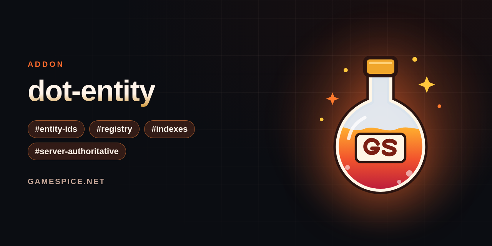

[](https://moddingcommunity.com/a/257-dot-entity)

One shared id for every world object, for Godot 4.7+. It hands out the integer ids that other addons, such as dot-combat, use to key their records, and it keeps two lookups: node to id, and your own key to id. Part of the [dot-*](https://github.com/gamespice-platform) family. It needs only [dot-core](https://github.com/gamespice-platform/core).

Before this addon, each game invented its own ids. One used the peer id for players and a hash of the engine instance id for monsters. Two monsters could collide in silence, and the loser then stopped taking damage. dot-entity is the one allocator that cannot collide.

## Install

1. Copy `addons/dot_entity/` and `addons/dot_core/` into your project.
2. Enable dot-entity in *Project > Project Settings > Plugins*.

## What an id is

```
id = kind * 1_000_000_000_000 + serial
```

```gdscript
var id := DotEntity.make_id(DotEntity.KIND_NPC, 41)

DotEntity.kind_of(id)                          # DotEntity.KIND_NPC
DotEntity.is_kind(id, DotEntity.KIND_PLAYER)   # false
DotEntity.describe_id(id)                      # "npc#41"
```

| Property | Why |
| --- | --- |
| An id carries its own kind. | The common question is "what sort of thing is this", for a kill feed, a friendly-fire rule or a spectator. It is one division, not a range check. |
| The stride is decimal. | People read these numbers in logs and bug reports, and `2000000000041` is visibly the forty-first NPC. |
| Zero is reserved. | dot-combat reads `0` as "no attacker" (a fall, the world). Nothing can allocate it. |
| Serials are never reused. | An id for a dead entity is absent from the table for the life of the process, so a stale id finds nothing instead of somebody else. |

The kinds are `KIND_PLAYER`, `KIND_NPC`, `KIND_VEHICLE`, `KIND_PROP`, `KIND_PROJECTILE`, `KIND_OBJECTIVE`, `KIND_TRIGGER` and `KIND_OTHER`. `KIND_OTHER` is for a game's own kind.

## Limits

The id layout is fixed: `id = kind * 10^12 + serial`. Inside it, the limits are settings. The defaults are the old values, so a game that sets nothing behaves as before. `0` means the largest value the layout holds. A value the layout cannot hold, or a negative one, is refused with `DotError.CODE_INVALID` and changes nothing. Nothing is clamped.

| Setting | Set with | Default | `0` means | Refused when |
| --- | --- | --- | --- | --- |
| `DotEntity.kind_limit`, the highest kind | `DotEntity.set_kind_limit(n)` | 8 | 9 223 371, the most kinds an `int64` id holds | below 8, or above 9 223 371 |
| `DotEntityTable.serial_limit`, serials per kind | `table.set_serial_limit(n)` | 999 999 999 999 (10^12 - 1) | the same ceiling | above 10^12 - 1 |

Kinds 9 and up are the game's own. Name them with `DotEntity.register_kind(kind, name)`, or they read as `kind9` in logs. Ids of kinds 1..8 are unchanged, so peers that disagree about `kind_limit` still agree about every id they share. Opening a kind above the limit fails with `CODE_INVALID`. Opening past `serial_limit` fails with `DotError.CODE_QUOTA` and never wraps.

## The table

```gdscript
var table := DotEntityTable.new()

var opened := table.open(DotEntity.KIND_PLAYER, body, &"", player.userid)
if opened.ok:
    var handle: DotEntityHandle = opened.value
    combat.register_health(handle.id, health)

# On despawn, in this order:
table.close(handle.id, DotEntityTable.REASON_KILLED)
combat.forget(handle.id)
```

`open(kind, node, owner_id, key, now)` refuses a null node, a node that is already an entity, a key that already names one and an unknown kind. Each refusal is a `DotResult` you can branch on. A refusal uses no serial.

`close()` does not free the node. Whoever put the node in the world takes it out. Close the handle first, so a listener on `closed` can still read where the entity was.

| Lookup | Use |
| --- | --- |
| `id_for_node(node)` | A trace returns a `Node` and damage is keyed by id, so this runs for every pellet. |
| `id_for_key(&"u123")` | Your game names players its own way, and dot-combat keys by int. |
| `key_for_id(id)` | The inverse. It is looked up and stored, never rebuilt from a formula. |

`sweep()` closes every handle whose node was freed without a `close()`, for example after a scene reload. It returns how many it closed and warns when that is more than zero, because it means a despawn path is not calling `close()`.

`DotEntityHandle` is kept beside the node and never on it. Metadata on a node is invisible to other code, survives into saved scenes, and is gone when the node is freed, which is the tick it matters most. It holds the common fields only. A prop, an NPC or a vehicle keeps its own record and gains a handle. Everything works in 2D and 3D: `position()` and `position_2d()` both return a safe value outside the tree.

## What is not here

There is no base class for entities, because this family keeps state in a record beside the node. There is no spawner, catalogue or budget layer yet. It is designed in [docs/design.md](docs/design.md#the-second-layer-designed-and-not-built) and not built.

## Who uses it

| Game | What it replaced |
| --- | --- |
| game-fatal-contact | `1_000_000 + (instance_id % 1_000_000)` for monsters, where two monsters could share an id. |
| mg-buses-from-hell | A counter with no `forget()`, which left a health record for every player who ever joined. |
| game-airdrift | `"u123"` parsed to `123`, one function doing two jobs. |
| game-playlot | A counter in one layer and a name hash in another, so one player had two ids. |

The client shell in dot-server-deploy links it as well. A delivered game pack resolves addon `class_name`s against the host build, so an addon a game uses must be in that list.

## Test

```bash
godot --headless --path . --import
godot --headless --path . res://examples/entity_selftest.tscn
```

The self-test is offline and exits non-zero on any failure. It checks that ids are unique, serials never repeat, and a stale id finds nothing.

## Status

Built and maintained with Claude Code. The test suites pass, but little of this has been in front of real players yet. Please report rough edges by opening an issue.

## Licence

MIT. See [LICENSE](LICENSE). Only the TMC back-end web infrastructure is not open source.
